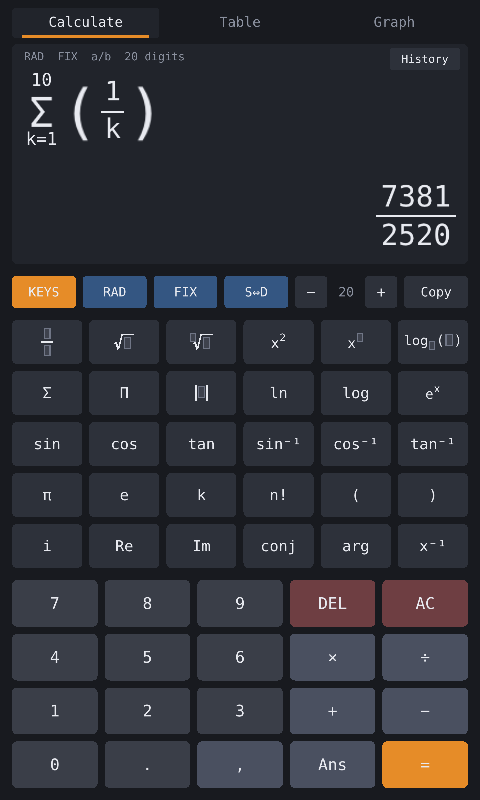
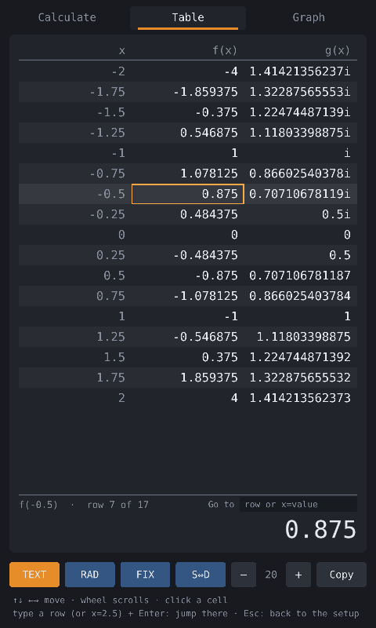
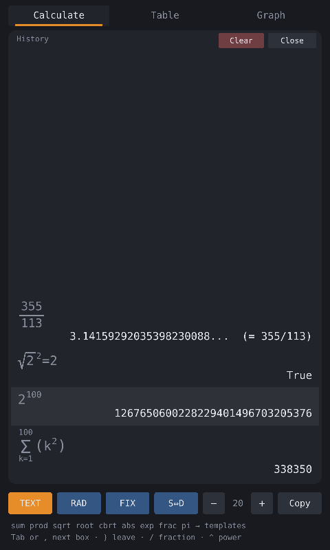
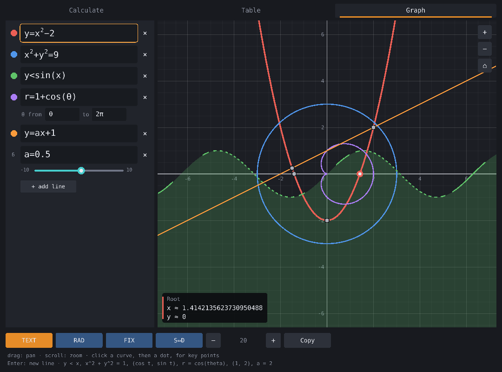
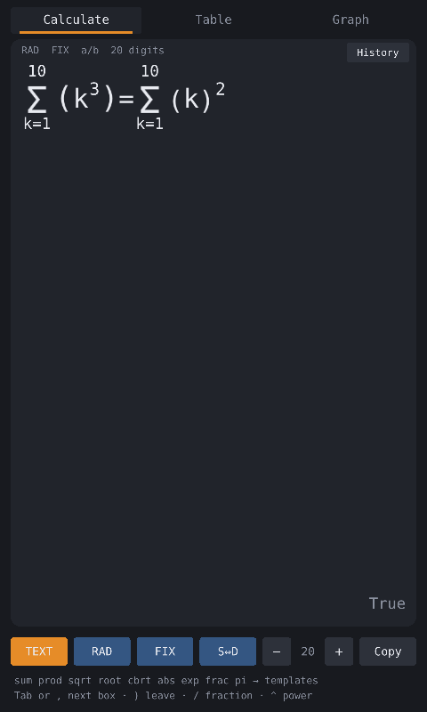

# CalcAll


A calculator in C that does it all and keeps numbers exact. Math is drawn the
way it looks on paper, like a Casio natural display. There are Casio-style
tables and a Desmos-style graph. The answer is always as exact as the math
allows: whole numbers show every digit (no `E+10` unless you ask for it),
fractions stay fractions, and anything approximate is marked `≈` and is
correct to every digit shown.

<p align="center">
  
  
  
</p>

<p align="center">
  
</p>

## What it can do

- **Natural display.** Fractions, roots, powers, logs, |x|, Σ, Π, ∫ and d/dx
  are templates with boxes to fill in, and the answer appears in the bottom
  right.
- **Type it or tap it.** In TEXT mode you just type: `sum` turns into Σ,
  `/` divides, Shift+`/` makes a fraction, `^` starts a power and Tab moves
  between boxes. KEYS mode brings back the calculator buttons.
- **Exact answers.** `2^100` shows all 31 digits, `0.1 + 0.2` is exactly
  `0.3`, and `1/3` is a fraction. S⇔D switches between fractions and
  decimals.
- **Any precision.** Show anywhere from a few digits to thousands
  (`:digits 1000` gives π to 1000 places).
- **Sums and products.** Σ and Π are built in, nested as deep as you like.
- **Derivatives and integrals.** `d/dx(x^3, 2)` is exactly 12, worked out by
  the rules rather than estimated. `∫₀¹ x² dx` is exactly 1/3, and
  `∫₀^π sin x dx` ≈ 2 to every digit shown.
- **Roots, logs and trig.** In radians or degrees, with inverse and
  hyperbolic functions.
- **Complex numbers.** `sqrt(-4)` = `2i`, `(1+2i)(3-i)` = `5 + 5i`, and
  `e^(iπ)` ≈ `-1`.
- **Variables and functions.** `x = 5`, `f(x) = x^2 + 1` and
  `g(a, b) = sqrt(a^2 + b^2)` are saved automatically and come back the next
  time you open it.
- **True or false checks.** These work like a Casio's verify mode:
  `2 + 2 = 4` → True, `355/113 > π` → True, `1 < x ≤ 5`.
- **History.** Past calculations are kept between sessions. Click one to use
  it again.
- **Tables.** Like a Casio's TABLE mode: f(x) and g(x) over a range, with a
  Go to box to jump to any row.
- **Graphing.** Like Desmos: curves, equations, inequalities, parametric and
  polar curves, points and sliders. Click a curve for its roots, turning
  points and crossings, worked out exactly.
- **A terminal version** with the same engine, for scripts and quick sums.

## Install

CalcAll needs [raylib](https://www.raylib.com) for its window. On macOS:

```sh
brew install raylib
make app            # builds CalcAll.app, with its icon
open CalcAll.app    # or drag it into Applications
```

To run it from the repository instead, use `make gui && ./calc-gui`. On Linux,
install raylib with your package manager (or build it from source), then run
`make gui`. If raylib is somewhere unusual, point the Makefile at it:

```sh
make gui RAYLIB_CFLAGS=-I/path/raylib/src RAYLIB_LIBS=/path/raylib/src/libraylib.a
```

`./calc-gui` looks for its font in `assets/`, so run it from the repository
folder or keep `assets` next to it. The app bundle carries its own copy.

The terminal version needs nothing but a C compiler:

```sh
make                # builds ./calc
make test           # runs the tests
```

## Using the app

The window has three tabs: **Calculate**, **Table** and **Graph**. Below the
screen, the mode bar has these switches:

- **TEXT/KEYS:** typing or buttons.
- **RAD/DEG:** radians or degrees.
- **FIX/SCI:** full digits or scientific notation.
- **S⇔D:** fraction or decimal.
- **− 20 +:** how many digits to show.
- **Copy:** copies the answer.

The app remembers all of these between sessions.

### Calculate

Type an expression and press Enter. In **TEXT** mode, which is the default,
what you type turns into templates:

| Type | Get |
|---|---|
| `sum`, `prod` | Σ or Π with boxes for the variable, start and end, and the body |
| `int` | ∫ with boxes for the variable, start and end, and the body |
| `d/dx(` | a derivative: `d/dx(x^3, 2)` is the slope of x³ at 2 |
| `sqrt`, `cbrt`, `root` | √ templates |
| `/` | ÷, plain division |
| Shift+`/` (`?`) | a fraction, with what's before it on top: `1`, Shift+`/`, `2+3` is ½ + 3 |
| `^` | a power: `2^10-1` is 2¹⁰ − 1 |
| `abs`, `exp`, `frac` | \|x\|, eˣ, a fraction |
| `pi`, `theta` | π, θ |
| `<=`, `>=`, `!=` | ≤, ≥, ≠ |
| `,` or Tab | the next box (Shift+Tab goes back) |
| `)` | leaves the box you're in |

Typing or pasting `sum(k=1, 10, k^2)` builds the whole Σ, and pasted text
turns `1/2` into a fraction. Use the arrow keys
to move the cursor: Up and Down move between the top and bottom of a
fraction or sum, and otherwise step through earlier answers. Esc clears the
line. Starting with an operator carries on from the last answer, so `×3`
becomes `Ans×3`.

**KEYS** mode shows the calculator buttons. They have the same templates, and
the keyboard still works.



**Calculus.** These follow the same pattern as Σ:
- **Integrals:** `int(x=0, 1, x^2)`, or Casio's order `int(x^2, 0, 1)`.
- **Derivatives:** `d/dx(f, a)` gives the slope at x = a. Leave the point out
  and `d/dx(f)` uses the current value of x, so `h(x) = d/dx(x^3)` defines the
  derivative as a function.

Derivatives are exact. The engine applies the rules (product rule, chain
rule and so on) and then works out the result, so `d/dx(x^3, 2)` is exactly
12, and `d/dx(d/dx(x^3), 2)` is a second derivative.

Integrals of polynomials are exact. Anything else uses tanh-sinh quadrature
at full precision. That handles ends where the function blows up, like
`∫₀¹ 1/√x dx` = 2. It also finds the corners and jumps of abs, floor and
round, and splits the integral there. If an integral never settles, like
∫₀¹ 1/x dx, it says so instead of showing a wrong number.

**True or false.** Type a comparison and it tells you whether it holds:

- `=`, `<`, `>`, `≤`, `≥` and `≠` all work, and so does a chain like
  `1 < x < 3`.
- Approximate values count as equal when they agree to the digits shown, so
  `sqrt(2)^2 = 2` is True.
- `x = 3` sets x. To check it, type `x == 3`.
- `!=` means "not equal". To check a factorial, write `(3!) = 6`.

**History.** The History button lists past calculations in the same natural
display. Click one to load it and work it out again. Clear empties the list.

<br clear="right">

### Table

Fill in f(x), and g(x) if you want a second column. Then fill in Start, End
and Step; expressions like `pi/4` are fine. Press Enter on Step, or the Table
button, to see the table.

- **Size:** up to 1000 rows. x goes up exactly, so a step of 0.1 never drifts.
- **Selecting:** use the arrow keys or click a cell. Its full value shows at
  the bottom, and Copy copies it.
- **Jumping:** type a row number, or `x=2.5` for the row whose x is closest,
  then press Enter.
- **Gaps:** cells that can't be computed, like 1/x at 0, show ERROR.
  Complex values show as complex.
- **Back:** Esc returns to the setup.

### Graph

Type one line per expression. Enter adds a new line, and the coloured dot
next to a line hides its curve.

| Line | Draws |
|---|---|
| `y = x^2`, `sin(x)`, `f(x) = ...` | a curve |
| `x^2 + y^2 = 9`, `xy = 1`, `x = y^2 - 4` | an equation's curve |
| `y < sin(x)`, `x^2 + y^2 <= 4` | a shaded region (a dashed edge isn't included) |
| `(3cos(t), 2sin(2t))` | a parametric curve, with t's range under the line |
| `r = 1 + cos(theta)` | a polar curve, with θ's range under the line |
| `(1, 2)`, `(1, 2), (-4, 1)` | points (click one for its exact coordinates) |
| `a = 2` | a slider |
| `y = d/dx(f(x))`, `y = int(t=0, x, f(t))` | the derivative or the area function of f |

A line that uses an undefined name, like `y = ax + 1`, offers a button to add
a slider for it.

To move around, drag to pan and scroll to zoom. The buttons at the top right
zoom too, and ⌂ goes back to the start. Hovering over a curve traces it.

Click a curve to show its key points: roots, turning points, the
y-intercept and crossings with other curves. Then click a dot and the exact
engine pins it down. The minimum of x² − 2x + 3 is exactly (1, 2), and a root
of x² − 2 is √2 to every digit.

Asymptotes and jumps (1/x, tan x, floor x) are left as gaps instead of being
joined up. Graph lines can use your own variables and functions.

## The terminal version

`./calc` runs the same engine in a terminal. It shares your saved
definitions and history with the app.

```
> 2^100
1267650600228229401496703205376
> prod(k=1, 10, k)
3628800
> sum(k=1, 100, k^2)
338350
> 0.1 + 0.2
0.3
> 1/3
0.33333333333333333333...  (= 1/3)
> sqrt(2)
≈ 1.4142135623730950488
> sqrt(2)^2 = 2
True
> f(x) = x^2 + 1
f(x) = x^2 + 1
> f(3i)
-8
> :table x^2 from 1 to 3 step 1
x                       f(x)
1                       1
2                       4
3                       9
```

There are three ways to run it:

- `./calc` starts the prompt.
- `./calc '50!'` works out one thing and exits.
- `echo '2^64' | ./calc` reads lines from a pipe.

`:help` lists everything.

## What it understands

| | |
|---|---|
| Operators | `+ - * / % ^ !` and parentheses |
| Numbers | `42`, `3.14`, `.5`, `6.02e23`, all stored exactly |
| Constants | `pi` (or `π`), `e` |
| Roots | `sqrt(x)`, `cbrt(x)`, `root(x, n)`, `x^(p/q)` |
| Logs | `ln(x)`, `log(x)` (base 10), `log2(x)`, `log(x, base)`, `exp(x)` |
| Trig | `sin cos tan asin acos atan sinh cosh tanh` |
| Complex | `i`, `3+4i`, `re im conj arg abs` |
| Sum | `sum(k=1, 100, k^2)` or `Σ(k=1, 100, k^2)` |
| Product | `prod(k=1, 10, k)` or `Π(k=1, 10, k)` |
| Other | `abs floor ceil round gcd lcm choose(n,k) perm(n,k)` |
| Variables | `x = 5`, `rate = 0.05`, `θ = pi/3`; `ans` (or `Ans`) is the previous result |
| Functions | `f(x) = x^2 + 1`, `g(a, b) = sqrt(a^2 + b^2)`, then `f(3)`, `g(3, 4)` |
| Implicit × | `2pi`, `3(4+1)`, `2sin(30)` multiply |
| Derivatives | `d/dx(x^3, 2)` (the slope at 2), `d/dx(sin(x))` (at the current x), `d/dt(...)` |
| Integrals | `int(x=0, 1, x^2)`, `int(x^2, 0, 1)`, `∫(t=0, pi, sin(t))` |
| True or false | `2 + 2 = 4` → True, `pi > 3.14`, `1 < x ≤ 5`, `x == 3`, `3 != 4` (or `≠`, `<>`) |
| Commands | `:deg`, `:rad`, `:sci`, `:fix`, `:digits N`, `:help`, `:quit` |
| Definitions | `:vars`, `:clear [name]`, `:save [file]`, `:load file` |
| History | `:history [N]` lists past calculations, `:history clear` forgets them |
| Tables | `:table x^2 + 1 from 1 to 5 step 1`, `:table sin(x); cos(x) from 0 to pi step pi/4` |

### How exact is it?

Exact values are true fractions of any size. Roots, logs and trig give an
exact answer when one exists (`sqrt(16)` = 4, `log(1000)` = 3, `sin(30)` =
1/2 in degrees). When there isn't one, the answer is an approximation computed
with 10 more digits than are shown, so every digit you see is correct. Real
and complex functions have been checked against [mpmath](https://mpmath.org)
to 50 digits.

Complex numbers stay exact when they can: `sqrt(3+4i)` = `2 + i` and
`abs(3+4i)` = `5`. Functions use their principal values, like most
calculators. Odd roots of negative numbers stay real, so `cbrt(-8)` and
`(-8)^(1/3)` are both `-2`.

### Variables and functions

- **Variables** keep the value their right side had when you defined them:
  `y = x^2` stays 25 even if x changes later.
- **Functions** are worked out each time they're used, so they see your
  current variables.
- **Built-in names** like `sin`, `pi` and `ans` can't be redefined.
- **Letters next to each other multiply** when there's no variable by that
  name, so with x and y defined, `xy` is x·y.

### Files

| File | Holds | Override |
|---|---|---|
| `~/.calc_definitions` | your variables and functions, saved after every change | `CALC_DEFINITIONS` |
| `~/.calc_history` | the last 500 calculations | `CALC_HISTORY` |
| `~/.calcall_settings` | the app's mode bar settings | |

Setting `CALC_DEFINITIONS` or `CALC_HISTORY` to an empty value turns that
file off. Values are saved as exact fractions, so `x = 1/3` comes back as
exactly 1/3.

## How it's built

Everything is plain C11. The only library it uses is raylib, for the window.

```
src/bigint.c    arbitrary-precision integers (add, multiply, long division)
src/rational.c  exact fractions on top of bigint, plus number formatting
src/approx.c    sqrt, pi, exp, ln, sin, cos, atan via series in fixed point
src/cmath.c     complex arithmetic and complex exp, ln, sqrt, sin, cos, ...
src/parser.c    text -> expression tree (recursive descent)
src/eval.c      walks the tree; tracks exact vs approximate; all functions
src/symbols.c   the table of user variables and functions
src/calculus.c  derivative rules, and integrals (tanh-sinh, Newton-Cotes)
src/calc.c      the engine API a front end calls: calc_eval(line) -> text
src/feval.c     fast floating-point evaluation for drawing graphs
src/graph.c     the graph's expression list, and exact key points
src/main.c      the terminal front end
src/mathedit.c  the natural-display editor: templates, cursor, to-text
src/gui.c       the raylib front end: screen, buttons, table and graph tabs
```

Both front ends talk to the engine through `calc.h`. They pass it a line of
text with `calc_eval` and show the text that comes back.

The bundled font is DejaVu Sans Mono; see `assets/DejaVu-LICENSE.txt`.
